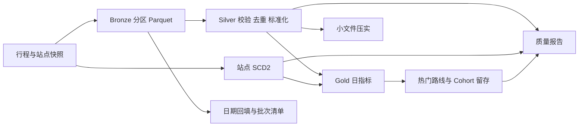

<div align="center">

# 共享单车离线湖仓与增量分析

基于 PySpark 与 Parquet 的分层湖仓，覆盖增量处理、时态维度、受控回填、质量治理和任务编排。

[](https://github.com/ZliY221/Offline-lake-warehouse-and-incremental-analysis-of-shared-bikes/actions/workflows/ci.yml)
[](https://github.com/ZliY221/Offline-lake-warehouse-and-incremental-analysis-of-shared-bikes/actions/workflows/portable-smoke.yml)


[快速启动](#快速启动) · [数据架构](#数据架构) · [核心能力](#核心能力) · [项目文档](#项目文档) · [版本记录](CHANGELOG.md)

</div>

## 项目简介

项目以共享单车行程和站点快照为数据源，构建 Bronze、Silver、Gold 三层离线湖仓。流水线支持显式 Schema、分区增量覆盖、冲突去重、站点 SCD2、热门路线与 cohort 留存分析，并提供日期回填、质量门禁、小文件压实、Airflow 编排和可恢复执行日志。

| 关注点 | 项目实现 |
| --- | --- |
| 数据分层 | Bronze 原始层、Silver 标准层、Gold 指标层 |
| 增量处理 | 日期分区覆盖、批次清单、跨分区主键保护 |
| 维度建模 | 站点 SCD2、行程事实与时态关联 |
| 数据治理 | 拒绝分流、跨层对账、回填审计、小文件压实 |
| 问题处置 | 质量异常自动生成分级修复建议与发布就绪状态 |
| 调度运维 | 本地任务图、重试恢复、Airflow TaskFlow DAG |

## 快速启动

仅运行数据生成和契约校验：

```powershell
python scripts/bootstrap.py -- --mode source
```

在 Linux、macOS 或配置好 WSL 的 Windows 上运行完整湖仓：

```powershell
python scripts/bootstrap.py -- --mode pipeline
```

主要结果位于 `build/quickstart/`，包括分层 Parquet、质量报告、编排状态和运行摘要。

## 数据架构



## 核心能力

### 分层湖仓

- 使用显式 Spark Schema 读取 NDJSON，按摄取日期写入 Bronze Parquet。
- 将合法、拒绝、重复和冲突记录分流，并派生业务日期与行程时长。
- 构建日指标、热门路线和 cohort 留存结果。

### 增量与回填

- 使用文件指纹和批次 ID 保证相同输入可安全重复执行。
- 回填前完成日期、路径和跨分区主键预检，仅重算受影响分区。
- 运行状态原子落盘，失败任务可按已有进度恢复。

### 质量与存储治理

- 检查分区连续性、新鲜度、行数守恒、拒绝率、SCD2 区间和 Gold 汇总。
- 对 Parquet 分区画像并生成稳定压实计划，执行前再次核对来源指纹。
- 压实日志提供完成比例、恢复状态和调度门禁退出码。

### 调度与可观测性

- 本地编排器与 Airflow DAG 复用同一任务定义。
- 保存 Job、Stage 和 Task 级 Shuffle、耗时、GC 与 Spill 指标。
- 保留物理计划、运行清单和审计报告，便于复核执行过程。
- 聚合多次运行控制快照，统计发布就绪率、质量失败与修复积压趋势。
- 对比总体与最近五次就绪率，并显示当前状态连续批次数，快速识别持续异常。
- 支持配置近期观察窗口与就绪阈值，输出 `HEALTHY`、`AT_RISK` 或 `NO_DATA` 趋势状态。
- 将失败检查按两倍权重与待处置动作合成为质量债务分，快速量化最新批次修复压力。
- 汇总近期平均、历史峰值和最新环比，识别质量债务的积累或回落。
- 为建议动作标记 P0 至 P3 优先级，让离线值守人员先处理高债务和发布阻断问题。
- 按优先级给出处置复核时限，并对 P0/P1 问题明确升级值守负责人的要求。
- 将最新批次的恢复动作汇总为稳定编号的离线恢复工作单，统一携带状态、优先级和复核要求。
- 根据批次生成时间与优先级自动计算工作单复核截止时间。
- 自动标记待复核、已逾期或无需复核，并统计逾期小时数。
- 按优先级路由工作单负责人，并生成可直接复制的交接摘要。
- 按清洁、可控和高债务区间统计批次分布，并突出近期高债务批次数。
- 根据发布状态、债务水平与近期趋势生成标准化下一步处置建议。

## 工程结构

```text
dags/                   Airflow TaskFlow DAG
data/                   匿名样例与质量场景
docs/                   架构和操作文档
evidence/               性能与执行计划证据
scripts/                启动、回填、压实和验收入口
src/bike_lakehouse/     分层作业与控制逻辑
tests/                  Python 与 Spark 验证
```

## 常用入口

| 目标 | 命令或入口 |
| --- | --- |
| 环境检查 | `python scripts/project_doctor.py --profile full` |
| 完整湖仓 | `python scripts/quickstart.py --mode pipeline` |
| 日期回填 | `./scripts/backfill-date.ps1 -IngestionDate 2026-10-01` |
| 小文件治理 | `./scripts/compact-lakehouse.ps1` |
| 压实状态 | `inspect-compaction-journal build/compaction/journal.json --pretty` |
| 质量处置计划 | `build-quality-actions --report build/reports/data-quality.json --output build/reports/quality-actions.json` |
| 离线运行控制中心 | `build-lakehouse-operations --quality-report build/reports/data-quality.json --orchestration-state build/control/orchestration-run.json --output-json build/operations/snapshot.json --output-html build/operations/index.html` |
| 多批次运行历史 | `build-lakehouse-history build/operations/run-*/snapshot.json --output-json build/history/history.json --output-html build/history/index.html`，同步展示近期健康状态、最新批次环比与退化原因 |
| 工程验收 | `./scripts/run-project-acceptance.ps1` |

## 项目文档

- [用户使用指南](docs/user-guide.md)
- [运行环境分层](docs/runtime-environments.md)
- [系统架构](docs/architecture.md)
- [增量处理与回填](docs/controlled-backfill.md)
- [数据质量报告](docs/cross-layer-quality.md)
- [Parquet 小文件治理](docs/parquet-compaction.md)
- [任务编排与恢复](docs/orchestration-retry.md)
- [Airflow DAG](docs/airflow-dag.md)

## 运行边界

- 数据全部为匿名合成数据，不包含真实骑行者和站点运营信息。
- Windows 原生环境适合数据源流程；完整 Parquet 流水线使用 WSL/Linux 或 macOS。
- 当前运行模式为 Spark `local[2]`，性能结果不代表分布式生产集群容量。
- 回填和压实具备写前保护与恢复能力，但不等同于事务湖表格式。

## 版本与维护

当前版本为 `v2.3.0`。每次发布同步维护[用户使用指南](docs/user-guide.md)、[版本记录](CHANGELOG.md)和[版本摘要](VERSION_LOG.md)。
